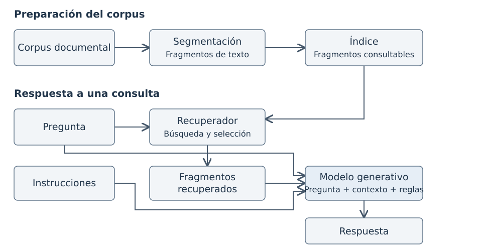

# 1. Objetivos del proyecto

## 1.1. Situación inicial y problema

Las instituciones educativas disponen de manuales, apuntes y guías docentes verificados, pero los estudiantes suelen encontrar dificultades para localizar con rapidez la explicación exacta que resuelve una duda concreta. Los modelos de lenguaje actuales ofrecen respuestas inmediatas y fluidas, aunque presentan un riesgo crítico en educación: pueden inventar datos, mezclar conceptos o dar por cierta una premisa errónea del alumno con una redacción totalmente convincente.

Para reducir este riesgo se emplean sistemas de **generación aumentada por recuperación de información** (RAG). En lugar de responder solo de memoria, el sistema busca primero los pasajes pertinentes dentro de los materiales oficiales de la asignatura y obliga al modelo generador a contestar apoyándose en ellos. Sin embargo, conectar un modelo a los documentos no garantiza el éxito por sí solo. Si el buscador selecciona fragmentos incompletos, o si el modelo interpreta mal los textos recibidos, la respuesta final perderá rigor académico.

## 1.2. Objetivos

Este proyecto aplica técnicas de Data Science para evaluar de forma controlada qué combinación de búsqueda documental y modelo generador ofrece mayores garantías antes de plantear un piloto en una institución educativa. Los objetivos concretos son:

- **Construir una base de datos documental trazable** a partir de manuales universitarios abiertos, conservando el vínculo exacto con cada capítulo, sección y página.
- **Diseñar un banco de evaluación riguroso** que incluya preguntas con vocabulario técnico y cotidiano, así como consultas con premisas falsas o sin respuesta en el temario.
- **Comparar cuatro estrategias de búsqueda de complejidad creciente** combinadas con tres modelos generadores ejecutados localmente.
- **Evaluar de forma separada** la localización de evidencia, la fundamentación documental, la corrección del contenido, la precisión de las citas, la tasa de entregas válidas y el tiempo de respuesta.
- **Proporcionar criterios de decisión y recomendaciones prácticas** para que la dirección académica pueda diseñar un piloto acotado con riesgos controlados.

# 2. Resumen de los resultados principales

El estudio evaluó **624 combinaciones experimentales** (26 preguntas base en dos formulaciones, cuatro estrategias de búsqueda y tres modelos generadores locales) sobre una base de **288 fragmentos** extraídos de dos manuales de estadística y ciencia de datos. Los hallazgos principales para la toma de decisiones son:

- **Las estrategias híbridas superan a la búsqueda simple en localización de evidencia.** Combinar la coincidencia de palabras con la búsqueda semántica mediante fusión de rankings (RRF) o reordenación (*reranking*) permitió recuperar el 54,8 % de los fragmentos clave conocidos en las diez primeras posiciones y alcanzó la mejor ordenación (nDCG\@10 de 0,735 con reordenación y 0,728 con RRF, frente a 0,706 en BM25 y 0,677 en búsqueda semántica).
- **No existe un único ganador en la calidad de la respuesta final.** La configuración óptima cambia según el modelo generador y la prioridad institucional. Con Qwen 3.5 9B, RRF lideró la fundamentación documental (1,98 sobre 2) y la precisión de citas (0,98 sobre 1), mientras que añadir reordenación maximizó la corrección (1,73 sobre 2) y la conducta ante casos límite (1,79 sobre 2). Con Qwen 3.5 4B, la reordenación encabezó tanto la fundamentación (1,93) como la corrección (1,68) con menor tiempo de respuesta.
- **La capacidad de entregar salidas válidas es determinante.** Los modelos Qwen 3.5 (4B y 9B) completaron el 100 % de las consultas previstas (208 de 208 en cada modelo). En cambio, Gemma 4 E4B registró los veinte fallos de formato del estudio (188 válidas de 208), lo que desaconseja elegir una configuración atendiendo únicamente a la nota media de sus respuestas completadas.
- **El modo en que pregunta el estudiante influye en el resultado.** Cuando la consulta describe una duda sin emplear el término técnico exacto del manual, empeora la búsqueda de evidencia en las cuatro estrategias y un modelo generador más grande no neutraliza por sí solo esa desventaja.

# 3. Aproximación elegida y preparación de los datos

## 3.1. Flujo general de la solución evaluada

La solución analizada divide el trabajo en dos fases: una preparación previa de los materiales docentes y un flujo de respuesta para cada consulta del usuario (@fig-sponsor-flujo).

{#fig-sponsor-flujo width="88%"}

Separar la búsqueda de la generación permite diagnosticar el origen de los fallos: distinguir cuándo el sistema falla porque no encontró el pasaje adecuado en los manuales y cuándo falla porque el modelo generador utilizó mal un pasaje que sí tenía disponible.

## 3.2. Extracción, limpieza y estructura de la base de datos

Para trabajar con material representativo de la enseñanza universitaria y auditable sin restricciones de confidencialidad, se seleccionaron seis capítulos de dos manuales abiertos de OpenStax en inglés (*Introductory Statistics 2e* y *Principles of Data Science*). Ambos comparten temas troncales (como intervalos de confianza y contrastes de hipótesis) explicados con distinto enfoque, lo que exige al buscador discriminar entre pasajes próximos de distintos documentos.

El procesamiento de datos transformó los PDF originales en una base documental limpia mediante tres pasos:

1. **Extracción y limpieza:** se procesaron 190 páginas (68.495 palabras), eliminando cabeceras, pies de página, índices, prefacios y solucionarios para evitar ruido en el buscador.
2. **Segmentación respetando la estructura docente:** en lugar de cortar el texto cada cierto número fijo de caracteres, los documentos se dividieron respetando siempre los límites de capítulo, sección y frase completa, con un objetivo de 300 palabras por fragmento y un solapamiento de hasta 60 palabras entre fragmentos consecutivos para no cortar explicaciones a la mitad.
3. **Trazabilidad e indexación:** se obtuvieron **288 fragmentos** (entre 107 y 327 palabras). Cada registro conserva su texto limpio, una versión enriquecida con el título del libro, capítulo y sección para facilitar la búsqueda, las páginas de origen y una huella digital del archivo fuente.

## 3.3. Banco de consultas, protocolo de evaluación y restricciones de los datos

Sobre los 288 fragmentos se construyó un conjunto de evaluación de **26 preguntas base**, redactadas cada una en dos versiones con idéntica intención informativa: una **explícita** (que incluye el término técnico, como «intervalo de confianza») y otra **implícita** (que describe el concepto sin nombrarlo). El conjunto evalúa tres comportamientos necesarios en educación: **responder** cuando hay base documental (17 preguntas), **corregir una premisa falsa** contenida en la pregunta (5 preguntas) y **abstenerse** cuando la respuesta no figura en los materiales (4 preguntas).

Para evaluar los buscadores se reunieron los fragmentos candidatos recuperados por las cuatro estrategias (578 pares únicos de pregunta y fragmento) y se graduó su utilidad en escala 0 (irrelevante), 1 (contexto parcial) y 2 (evidencia directamente útil). Para evaluar las 604 respuestas válidas de los generadores, dos jueces automáticos puntuaron a ciegas cada salida y el investigador revisó y adjudicó manualmente los **233 criterios en los que hubo discrepancia** (repartidos en 158 respuestas).

Durante la preparación de los datos se identificaron tres **restricciones principales**:

- **Expresiones matemáticas en PDF:** la extracción automática desde PDF puede degradar fórmulas complejas. El control inicial señaló cinco fragmentos con riesgo en fórmulas y la revisión posterior de las justificaciones detectó veinte fragmentos con pérdida matemática parcial.
- **Cobertura acotada de los juicios:** por coste de anotación, se evaluaron los fragmentos recuperados por los métodos comparados y no las más de siete mil combinaciones posibles con todo el corpus.
- **Ausencia de réplicas de concurrencia:** la generación se ejecutó de manera secuencial en una estación local con tarjeta gráfica RTX 2060 SUPER, permitiendo hasta tres intentos cuando una salida incumplía el formato de entrega.

# 4. Descripción de los modelos

## 4.1. El papel del modelo de referencia (*baseline*)

En un proyecto de Data Science, una técnica compleja o costosa solo se justifica si supera de manera clara a una solución sencilla. Por ello se incluye **BM25** como modelo de referencia (*baseline*). BM25 puntúa los fragmentos según la coincidencia exacta de las palabras de la pregunta, ponderando más los términos específicos del temario y corrigiendo por la longitud del texto, sin emplear redes neuronales. Mantener esta referencia permite comprobar en qué casos la búsqueda vectorial, la fusión híbrida o la reordenación aportan un valor real sobre un buscador clásico.

## 4.2. Estrategias de recuperación comparadas

Se evaluaron cuatro estrategias que entregan siempre cinco fragmentos de contexto al modelo generador:

| Estrategia | Cómo selecciona los fragmentos | Ventajas principales | Inconvenientes y costes |
|---|---|---|---|
| **BM25 (referencia)** | Busca coincidencias exactas de las palabras de la consulta y pondera su rareza en el corpus | Muy rápido, interpretable, bajo consumo de recursos y eficaz cuando el alumno usa el término exacto | Pierde eficacia si el estudiante describe su duda con palabras distintas a las del manual |
| **Búsqueda semántica** | Convierte preguntas y fragmentos en vectores numéricos (E5-base-v2) y mide su proximidad conceptual | Localiza pasajes relacionados aunque no compartan las mismas palabras exactas | Puede recuperar textos del mismo tema general que no resuelven la pregunta concreta y requiere GPU o CPU dedicada |
| **Fusión híbrida (RRF)** | Combina las diez primeras posiciones de BM25 y de la búsqueda semántica en una lista única | Aprovecha aciertos léxicos y conceptuales sin necesidad de calibrar escalas distintas | Exige ejecutar ambos buscadores en cada consulta y puede arrastrar candidatos irrelevantes si ambos fallan |
| **RRF + reordenación** | Aplica una red adicional (*cross-encoder* MiniLM-L6-v2) que lee juntos la pregunta y cada uno de los diez candidatos de RRF para elegir los cinco primeros | Refina el orden final y sitúa en las primeras posiciones los fragmentos más pertinentes | Añade tiempo de cómputo en cada consulta y no puede rescatar un fragmento que no estuviera ya entre los diez candidatos de RRF |

: *Características, ventajas e inconvenientes de las cuatro estrategias de búsqueda* {#tbl-sponsor-modelos-ir}

## 4.3. Modelos generadores evaluados

Para comprobar si la ventaja de un buscador se mantiene al cambiar el modelo que redacta la respuesta, las cuatro estrategias se cruzaron con tres modelos abiertos ejecutados localmente mediante Ollama: **Gemma 4 E4B** y dos tamaños de una misma familia y versión, **Qwen 3.5 4B** y **Qwen 3.5 9B**. Todos recibieron idénticas instrucciones, temperatura cero para favorecer la reproducibilidad y la obligación de declarar el tipo de actuación (respuesta, corrección o abstención) junto con los identificadores de los fragmentos citados.

# 5. Resultados principales y conclusiones

## 5.1. Rendimiento en la búsqueda de evidencia y efecto del vocabulario

La comparación de los cuatro buscadores confirma la utilidad de combinar señales léxicas y semánticas (@fig-sponsor-recuperacion). En el corte de cinco fragmentos (los que efectivamente recibe el generador), **RRF con reordenación** alcanza la mayor cobertura (43,0 % de la evidencia clave conocida) y la mejor calidad de ordenación (nDCG\@5 de 0,733), seguida de **RRF** (42,7 % y 0,719). Al ampliar la vista a diez fragmentos, RRF y la reordenación empatan en cobertura (54,8 %) porque comparten los mismos diez candidatos, pero la segunda fase de reordenación mejora la posición de los pasajes más útiles (nDCG\@10 de 0,735 frente a 0,728).

```{r}
#| label: fig-sponsor-recuperacion
#| echo: false
#| warning: false
#| message: false
#| fig-cap: "Cobertura de evidencia clave (Recall) y calidad de ordenación (nDCG) en los cinco y diez primeros resultados de cada estrategia (medias sobre 26 preguntas base)."
#| fig-width: 6.8
#| fig-height: 2.55

library(dplyr)
library(ggplot2)
library(tibble)

ir <- read.csv("outputs/local_runs/academic_corrections_20260930/retrieval/evaluation/aggregate_metrics.csv") |>
  filter(cohort == "all_pairs")

metodos_ir <- c("bm25", "dense", "rrf", "rerank")
nombres_ir <- c("BM25", "Semántica", "RRF", "RRF + reranking")

ir_l <- bind_rows(lapply(c("recall", "ndcg"), function(cr) {
  tibble(
    metodo = factor(ir$method, levels = rev(metodos_ir), labels = rev(nombres_ir)),
    corte = factor(ir$k, levels = c(5, 10), labels = c("Top 5 (entregados al generador)", "Top 10 (candidatos)")),
    metrica = factor(cr, levels = c("recall", "ndcg"),
      labels = c("Cobertura (Recall)", "Calidad de orden (nDCG)")),
    valor = ir[[cr]]
  )
})) |>
  mutate(y_pos = as.numeric(metodo) + if_else(corte == "Top 10 (candidatos)", 0.20, -0.20))

ggplot(ir_l, aes(x = valor, y = y_pos, color = corte)) +
  geom_point(size = 2.3) +
  geom_text(aes(label = format(round(valor, 3), nsmall = 3, decimal.mark = ",")),
    hjust = -0.3, size = 2.4, show.legend = FALSE) +
  facet_wrap(~metrica, nrow = 1, scales = "free_x") +
  scale_x_continuous(expand = expansion(mult = c(0.08, 0.24)),
    labels = function(x) format(round(x, 2), nsmall = 2, decimal.mark = ",")) +
  scale_y_continuous(breaks = seq_along(nombres_ir), labels = rev(nombres_ir),
    expand = expansion(add = 0.5)) +
  scale_color_manual(values = c("#315C8C", "#C56A31")) +
  labs(title = "Rendimiento de las estrategias de búsqueda documental",
    x = "Puntuación media (escala 0–1)", y = NULL, color = NULL) +
  theme_minimal(base_size = 8.8) +
  theme(legend.position = "bottom", panel.grid.major.y = element_blank(),
    panel.grid.minor = element_blank(), strip.text = element_text(face = "bold"),
    plot.title = element_text(face = "bold", size = 10))
```

La búsqueda semántica por sí sola recupera algo más de evidencia a diez posiciones que BM25 (51,8 % frente a 50,7 %), pero ordena peor los primeros resultados (nDCG\@10 de 0,677 frente a 0,706). Además, cuando se comparan las preguntas explícitas con las implícitas, **los cuatro buscadores pierden cobertura y calidad de ordenación al retirarse el término técnico** (con caídas medias de Recall\@10 de 0,118 a 0,141 puntos). Aunque estas diferencias no conservan significación estadística tras el ajuste por comparaciones múltiples, muestran que las consultas formuladas con vocabulario coloquial siguen siendo un reto incluso para los métodos semánticos e híbridos.

## 5.2. Calidad de las respuestas, entregas válidas y tiempos

En la respuesta final generada para el estudiante, la ventaja de un buscador depende del modelo generador con el que se combine (@fig-sponsor-calidad) y debe valorarse junto con la fiabilidad de entrega y el tiempo de respuesta (@tbl-sponsor-candidatas).

```{r}
#| label: fig-sponsor-calidad
#| echo: false
#| warning: false
#| message: false
#| fig-cap: "Fundamentación y corrección medias (escala 0–2) por buscador dentro de cada generador sobre preguntas comunes (Gemma: 18 bases, Qwen 4B y 9B: 22 bases)."
#| fig-width: 6.8
#| fig-height: 2.5

calidad <- read.csv("outputs/local_runs/final_experiment_20260930/analysis/per_retriever.csv")

calidad_l <- bind_rows(lapply(c("faithfulness", "factual_correctness"), function(cr) {
  tibble(
    generador = factor(calidad$generator_model,
      levels = c("gemma4:e4b", "qwen3.5:4b", "qwen3.5:9b"),
      labels = c("Gemma 4 E4B", "Qwen 3.5 4B", "Qwen 3.5 9B")),
    metodo = factor(calidad$retrieval_condition, levels = rev(metodos_ir), labels = rev(nombres_ir)),
    criterio = factor(cr, levels = c("faithfulness", "factual_correctness"),
      labels = c("Fundamentación (0–2)", "Corrección (0–2)")),
    valor = calidad[[paste0(cr, "_mean")]]
  )
})) |>
  mutate(y_pos = as.numeric(metodo) + if_else(criterio == "Fundamentación (0–2)", 0.14, -0.14))

ggplot(calidad_l, aes(x = valor, y = y_pos, color = criterio)) +
  geom_point(size = 2.4) +
  geom_text(aes(label = format(round(valor, 2), nsmall = 2, decimal.mark = ",")),
    hjust = -0.35, size = 2.5, show.legend = FALSE) +
  facet_wrap(~generador, nrow = 1) +
  scale_x_continuous(limits = c(1.3, 2.2), breaks = c(1.4, 1.6, 1.8, 2.0),
    labels = function(x) format(x, nsmall = 1, decimal.mark = ",")) +
  scale_y_continuous(breaks = seq_along(nombres_ir), labels = rev(nombres_ir),
    expand = expansion(add = 0.45)) +
  scale_color_manual(values = c("#315C8C", "#C56A31")) +
  labs(title = "Calidad de contenido por combinación de generador y búsqueda",
    x = "Puntuación media (escala 0–2)", y = NULL, color = NULL) +
  theme_minimal(base_size = 8.8) +
  theme(legend.position = "bottom", panel.grid.major.y = element_blank(),
    panel.grid.minor = element_blank(), strip.text = element_text(face = "bold"),
    plot.title = element_text(face = "bold", size = 10))
```

| Prioridad institucional | Combinación destacada | Medias observadas y entregas válidas | Compromiso operativo |
|---|---|---|---|
| **Respaldo documental y citas** | Qwen 3.5 9B + RRF | Fundamentación: 1,98/2 · Citas: 0,98/1 · Válidas: 52/52 (3,84 s) | Corrección (1,70) y conducta (1,75) ligeramente menores que con reordenación |
| **Corrección y conducta** | Qwen 3.5 9B + RRF con reordenación | Corrección: 1,73/2 · Conducta: 1,79/2 · Válidas: 52/52 (3,94 s) | Menor precisión de citas (0,94/1) y cómputo adicional del reordenador |
| **Menor tiempo sin fallos de entrega** | Qwen 3.5 4B + RRF con reordenación | Fundamentación: 1,93/2 · Corrección: 1,68/2 · Válidas: 52/52 (2,63 s) | Menor soporte de citas (0,90/1) y menor conducta que RRF simple (1,69 frente a 1,71) |
| **Alternativa con Gemma 4 E4B** | Gemma 4 E4B + semántica o reordenación | Corrección con semántica: 1,58/2 · Fundamentación con reordenación: 1,86/2 | Acumula los 20 fallos de salida del estudio (entre 44/52 y 49/52 válidas según buscador) |

: *Configuraciones candidatas según prioridad, resultados medios y tasa de entregas válidas* {#tbl-sponsor-candidatas}

1. **El modelo mayor aprovecha mejor las fuentes, pero no sustituye al buscador.** Sobre las mismas preguntas, Qwen 3.5 9B supera a Qwen 3.5 4B en fundamentación (+0,148 puntos en la escala 0–2) y obtiene las mayores medias de contenido, aunque persisten diferencias entre estrategias de búsqueda dentro de cada modelo y no se atenúa la caída ante preguntas implícitas.
2. **Calidad media y tasa de entrega deben analizarse juntas.** Mientras los dos modelos Qwen completaron las 208 salidas previstas cada uno, Gemma 4 E4B falló en veinte ocasiones al generar el formato y las citas requeridas. En un servicio real, un fallo de entrega equivale a una consulta no atendida.
3. **Estar respaldado por las fuentes no equivale a responder de forma completa.** El análisis de perfiles sobre las respuestas válidas mostró que en los tres modelos existen numerosas respuestas cuyas afirmaciones están fielmente contenidas en los fragmentos (fundamentación 2/2) pero que omiten parte de la explicación necesaria (corrección menor que 2): 38 casos en cada generador. Por tanto, supervisar únicamente la ausencia de alucinaciones no garantiza que la respuesta sea completa.
4. **Los tiempos de generación permiten dimensionar el piloto, pero dependen del tamaño del modelo.** La media por consulta válida pasó de 2,54–2,73 segundos en Qwen 3.5 4B a 3,84–3,95 segundos en Qwen 3.5 9B.

## 5.3. Pautas de selección según el escenario institucional

- **Si la prioridad es minimizar afirmaciones sin respaldo y asegurar citas exactas:** emplear **Qwen 3.5 9B con fusión híbrida (RRF)**, que alcanzó la mayor fundamentación media (1,98/2) y un 98,1 % de citas válidas sin necesidad de ejecutar el modelo de reordenación.
- **Si la prioridad es maximizar la completitud de la respuesta y la detección de premisas erróneas:** emplear **Qwen 3.5 9B con RRF y reordenación**, que obtuvo las mayores medias en corrección (1,73/2) y adecuación conductual (1,79/2).
- **Si la infraestructura local es ajustada o se prioriza una respuesta más rápida sin fallos de servicio:** emplear **Qwen 3.5 4B con RRF y reordenación**, que reduce el tiempo medio de generación en más de un segundo por consulta respecto al modelo de 9B manteniendo un 100 % de entregas válidas y un alto respaldo documental (1,93/2).
- **En cualquiera de los escenarios anteriores:** conservar **BM25** como línea base de control para verificar que la ganancia de las opciones híbridas se mantiene sobre los materiales propios de la asignatura.

# 6. Recomendaciones

## 6.1. Aplicaciones potenciales en la institución educativa

- **Consulta verificada de bibliografía y guías docentes en el campus virtual:** ofrecer un buscador asistido que responda dudas puntuales sobre el material oficial mostrando siempre el capítulo, la sección y el pasaje literal de origen, y absteniéndose de contestar cuando la información no figure en los documentos.
- **Herramienta de apoyo para el profesorado:** utilizar el sistema internamente para localizar con rapidez pasajes relevantes entre distintos manuales, verificar referencias cruzadas y preparar bancos de preguntas o materiales de repaso fundamentados en la bibliografía de la asignatura.
- **Detección de lagunas en los apuntes y dudas frecuentes:** aprovechar los registros de abstención y las consultas formuladas con lenguaje no técnico para identificar qué apartados del material docente resultan confusos o insuficientes para los estudiantes.

## 6.2. Condiciones para el piloto y control de riesgos

La recomendación ejecutiva es **autorizar un piloto técnico acotado a una asignatura y supervisado por su equipo docente**, descartando un despliegue general sin validación previa. Antes de iniciar el piloto deben fijarse cinco condiciones operativas y aplicar las medidas de mitigación de la @tbl-sponsor-riesgos:

1. **Licencias y mantenimiento documental:** verificar que los materiales de la asignatura permiten su indexación y definir cómo se actualizarán los fragmentos cuando cambie el temario.
2. **Umbrales de aceptación previos:** acordar antes de medir el piloto los valores mínimos exigibles por separado en fundamentación, corrección, precisión de citas, abstención y porcentaje máximo de fallos de entrega.
3. **Banco de pruebas con consultas reales de alumnos:** incorporar preguntas redactadas sin jerga académica, errores conceptuales habituales y consultas fuera de temario.
4. **Medición operativa de extremo a extremo:** evaluar en la infraestructura prevista la latencia total (búsqueda más generación), la concurrencia de usuarios y el coste completo de cómputo y mantenimiento.
5. **Supervisión docente y pautas pedagógicas:** asignar responsables para auditar muestras de respuestas y configurar el asistente para ofrecer pistas graduadas cuando el objetivo sea que el estudiante resuelva una tarea por sí mismo.

| Riesgo principal | Implicación para la institución | Mitigación requerida en el piloto |
|---|---|---|
| **Cambio de idioma y de asignatura** | Los resultados obtenidos sobre dos manuales de estadística en inglés no se trasladan automáticamente a asignaturas en español o con otra estructura documental | Construir un conjunto de evaluación en el idioma docente y validar modelos multilingües propios antes de decidir |
| **Degradación de fórmulas en PDF** | La extracción automática puede alterar expresiones matemáticas o tablas y afectar a asignaturas cuantitativas | Auditar la legibilidad de los fragmentos con fórmulas tras la extracción antes de indexarlos en el buscador |
| **Sesgo de evaluación automática** | Los jueces automáticos pueden coincidir en errores y dar por válidas respuestas incompletas o citas imprecisas | Revisar con profesorado de la asignatura tanto las discrepancias entre jueces como una muestra aleatoria de consensos |
| **Sustitución del esfuerzo del alumno** | Entregar respuestas directas, aunque estén bien fundamentadas, puede reducir el aprendizaje autónomo posterior sin ayuda | Incorporar pautas pedagógicas (*guardrails*) orientadas a dar pistas y evaluar el impacto real en el estudiante |

: *Riesgos identificados y medidas de control para la validación institucional* {#tbl-sponsor-riesgos}
